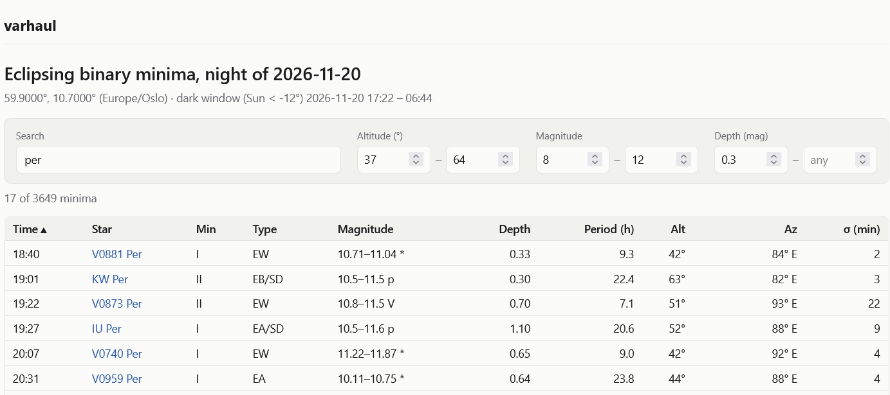

varhaul
=======

Variable star observation planner, based on Suhora ephemeris.

Given a date and an observer location, varhaul finds every primary and
secondary minimum of an eclipsing binary that falls in that night's dark
window while the star is above the horizon. It writes them to a
static, self-contained HTML page with a sortable table you can filter by
name, type, altitude, magnitude range and eclipse depth.



Installation
------------

varhaul needs Python 3.14 and [uv](https://docs.astral.sh/uv/).

```sh
git clone https://github.com/zsiciarz/varhaul.git
cd varhaul
uv sync
```

The catalogues it needs are not included in this repository; see
[Data](#data) below.

Usage
-----

```sh
uv run varhaul                      # tonight, from Warsaw
uv run varhaul 2026-12-24 --lat 50.06 --lon 19.94 -o christmas.html
```

| Option | Default | Meaning |
| --- | --- | --- |
| `DATE` | today | evening date of the night |
| `--lat`, `--lon` | 52.2297, 21.0122 (Warsaw) | observer location, degrees N / E |
| `--tz` | `Europe/Warsaw` | timezone for displayed times |
| `--sun-alt` | −12 | Sun altitude that defines the dark window |
| `--ephem` | `data/ephem.txt` | eclipsing-binary ephemeris |
| `--gcvs` | `data/gcvs5.txt` | GCVS catalogue |
| `-o`, `--output` | `minima-DATE.html` | HTML file to write |

Times of minima come from linear elements, so expect them to drift from the
real ones for stars with poorly determined or changing periods. The σ column
gives the timing uncertainty propagated from the elements.

Data
----

varhaul reads two catalogues that you have to download yourself and place in
`data/`:

- **`data/ephem.txt`**: *Up-to-date linear elements of eclipsing binaries*
  by J. M. Kreiner, maintained at Mt. Suhora Observatory, Pedagogical
  University of Kraków (<http://www.as.up.krakow.pl/ephem/>). Save the
  combined list of elements as `data/ephem.txt`.
- **`data/gcvs5.txt`**: the General Catalogue of Variable Stars, version 5.1,
  from Sternberg Astronomical Institute, Moscow
  (<http://www.sai.msu.su/gcvs/gcvs/gcvs5/gcvs5.txt>), also available from
  VizieR as catalogue B/gcvs. varhaul takes the stars' positions,
  magnitude ranges and variability types from it.

If you use results from varhaul in published work, please cite the
catalogues:

- Kreiner, J. M. 2004, *Up-to-date linear elements of eclipsing binaries*,
  Acta Astronomica 54, 207
- Samus, N. N., Kazarovets, E. V., Durlevich, O. V., Kireeva, N. N.,
  Pastukhova, E. N. 2017, *General catalogue of variable stars: Version GCVS
  5.1*, Astronomy Reports 61, 80

The catalogues remain the work of their authors and are subject to their
terms; varhaul's licence covers only its own code.

License
-------

MIT; see [LICENSE.md](LICENSE.md).
